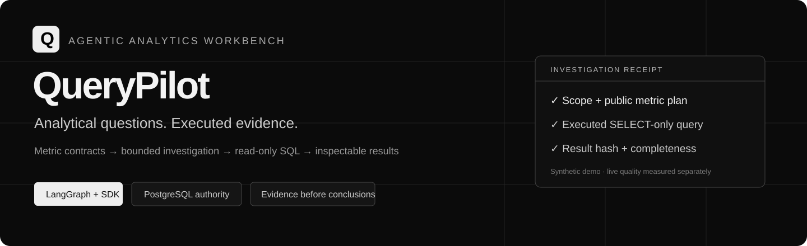
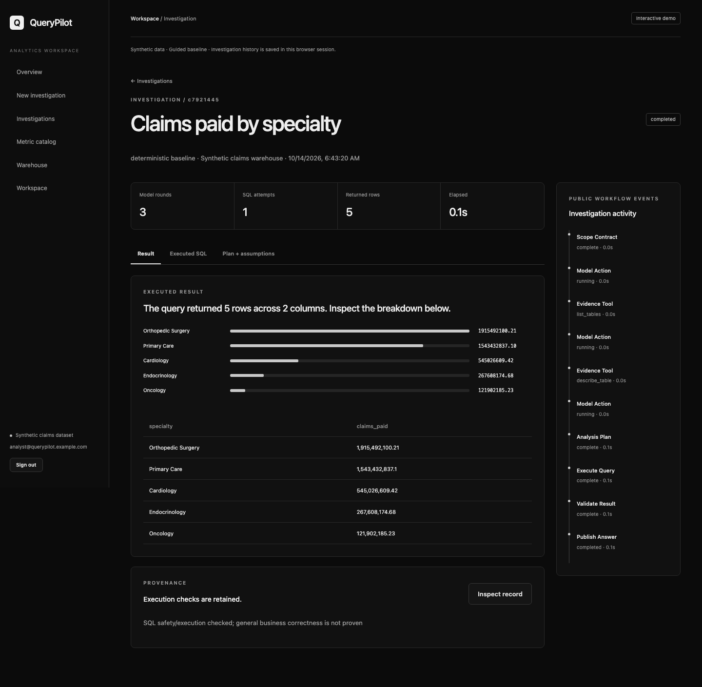
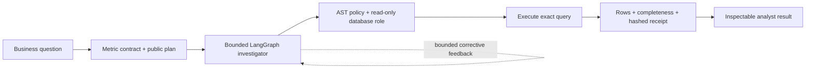

<p align="center"></p>

<p align="center">
<a href="https://github.com/Akhilesh-Vangala/querypilot/actions/workflows/ci.yml"></a>


<a href="LICENSE"></a>
</p>

**An agentic analytics workbench for claims and provider-network operations.** Ask a business question, inspect its public metric plan, execute a bounded read-only query, and retain the evidence behind the result.

**[Open the live synthetic demo](https://querypilot-five.vercel.app) · [Verified delivery](docs/EVIDENCE.md) · [Architecture](docs/ARCHITECTURE.md) · [Evaluation](docs/EVALUATION.md) · [Deployment](docs/DEPLOYMENT.md) · [Tradeoffs](docs/DECISIONS.md) · [Progress](PROGRESS.md)**

## The business problem

Claims spend, declined referrals, provider capacity and coordination costs have different grains and denominators. A plausible query can double-count spend or average the wrong rate. Analysts need a faster route to an answer with inspectable metric assumptions, SQL, completeness and evidence. QueryPilot supplies that workflow over an explicitly synthetic healthcare operations warehouse.



*Actual application capture. Guided deterministic investigator; no live model request or customer data.*

## What is engineered here

| Layer | Owned behavior |
| --- | --- |
| Applied AI | Five reviewed metric contracts carry grain, units, weighted denominators and latest-data time anchors into analysis. |
| Agentic workflow | LangGraph coordinates typed model actions, schema inspection, public planning, SQL evidence, bounded correction and final execution. |
| Native generation | Official OpenAI Responses SDK, strict function schemas, local Pydantic validation, context/token/round limits and no automatic paid replay. |
| Query authority | SQLGlot AST/scope checks, reviewed relation/function allowlists, raw fact fan-out rejection and separate SELECT-only PostgreSQL credentials. |
| Bounded execution | Independent read-only transaction, statement timeout and row/column/byte budgets. Displayed numeric summaries derive from executed rows. |
| Durable coordination | PostgreSQL admission, idempotency, four-worker rehearsal, user-scoped history, leases and owner-fenced publication. Interrupted work requires explicit resubmission. |
| Product | Monochrome overview, investigation composer, persistent detail routes, result/SQL/plan tabs, provenance dialog, searchable history, metric catalog and warehouse explorer. |
| Operations | Non-root API/worker/frontend images, one-shot migration/role bootstrap, Compose, health checks, privacy-conscious OTLP spans and actual container/browser/restart CI. |



**Policy remains application-owned.** The model proposes queries; it cannot grant itself tables/tools, write warehouse data or read application identities. Successful query execution is evidence of execution, not a proof of arbitrary business semantics or causality.

## Run it

```sh
git clone https://github.com/Akhilesh-Vangala/querypilot.git
cd querypilot
docker compose up --build -d --wait db api worker frontend
```

Open **http://localhost:3007**. Select the analyst or evaluation demo. These known accounts and Compose passwords are for isolated synthetic development only. A separate worker processes investigations; PostgreSQL preserves their history across API restarts. Private production uses separate secrets/accounts and disables every demo/startup flag; see [deployment](docs/DEPLOYMENT.md).

For native Python 3.13 development, install hashed dependencies from `backend/requirements-dev.txt`, copy `.env.example` to ignored `.env`, create `.tools/`, run `uvicorn app.main:app --app-dir backend --port 8007`, then `npm ci && npm run dev` in `frontend/`.

### Choose the investigator explicitly

- **Guided baseline:** deterministic compiler for known development intents; no model cost.
- **Live model:** private `OPENAI_API_KEY`, `ALLOW_LIVE_AI=true`, and explicit live selection. Default model is `gpt-4o-mini`; provider calls use the official SDK. No key is required to reproduce the engineering checks.
- **Public Vercel demo:** forced synthetic guided mode, actual guarded SQL within the request, browser-session history. It is separate from the persistent PostgreSQL runtime; no durable serverless filesystem or background worker claim.

## Evidence, honestly scoped

| Check | Recorded local result |
| --- | --- |
| Original baseline | 30 backend tests passed before changes |
| Expanded policy/workflow/SDK/API suite | 74 tests passed; mocked transport, no paid calls |
| New graph on real PostgreSQL | 12/12 known development cases match independent gold results |
| Concurrent workers | Four claimants complete 12 queued cases; idempotency and stale-owner fencing pass |
| Independent database authority | Reader cannot read app identities or write warehouse; app role cannot read facts |
| Actual Chromium journey | Result, SQL, plan, modal/Escape, reload history, metrics and mobile overflow checks pass |
| Frontend dependency audit | Zero reported vulnerabilities after explicit upgrades |
| Live held-out AI quality | **Not run** |
| Persistent monitored cloud execution | **Not deployed** |

```sh
python -m pytest -q backend/tests
docker compose --profile test run --build --rm tests
python scripts/browser_smoke.py
python scripts/benchmark.py --mode baseline --suite regression --case-limit 12
```

The benchmark runner also defines **34 separate filtered/safety cases** and records execution accuracy, model usage, attempts, rounds, latency and source hashes. A live evaluation requires an explicit paid opt-in; no deterministic fallback or invented model score. See [evaluation design and limits](docs/EVALUATION.md).

## System boundaries and next release gates

The warehouse contains 80 weekly synthetic snapshots from January 6, 2025, two regions, three employer groups and five specialties. Original data/history are preserved. Monetary fixture fields remain floating point; the legacy last-12-month question uses 52 latest weekly snapshots.

Current limits: live-model quality is unverified; metric guidance does not guarantee semantic correctness; inner graph state is not checkpointed; interrupted generation is not automatically resumed; user-owned investigations share one organization warehouse; OIDC/tenant data access, global dollar budgets, managed schema migrations, backup restore, load/SLO evidence and actual analyst feedback remain customer-release gates. Do not treat the public demo as a customer-production certification.

## Repository map

```text
backend/app/agent/   graph · strict actions · metrics · SDK · SQL policy
backend/app/         API · auth · run queue · worker · bootstrap · telemetry
backend/tests/      preserved regression + adversarial/workflow/transport checks
frontend/src/       React product pages, tables/charts and provenance interface
scripts/            PostgreSQL rehearsal · browser/restart smoke · benchmarks
docs/               architecture · tradeoffs · evaluation · deployment · actual captures
.github/            reproducible CI · dependency updates · review workflow
```

[Branch policy](BRANCHING.md): short-lived work branches → required backend/frontend/container checks → protected squash merge to main. Preserve original history. MIT; see [LICENSE](LICENSE).
