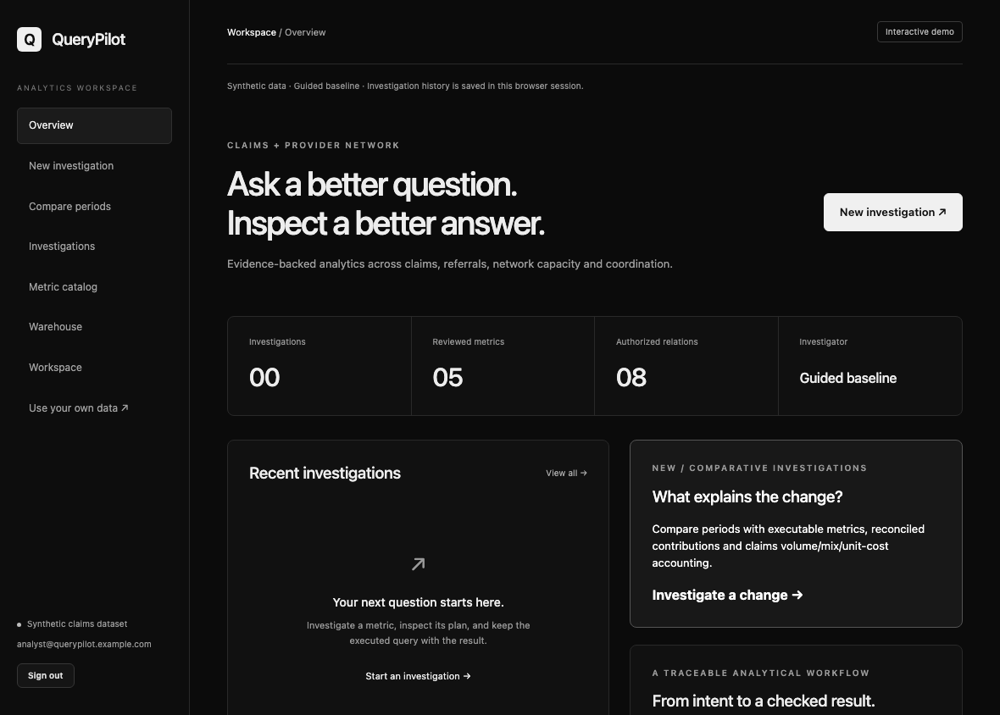
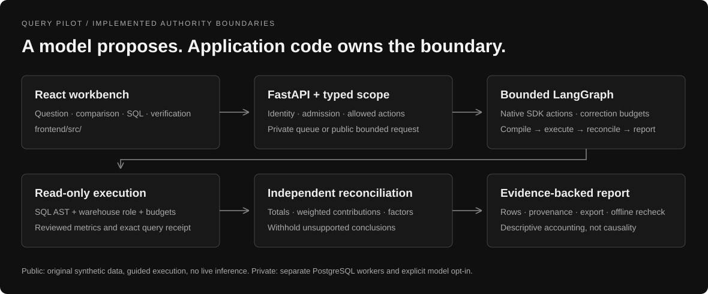
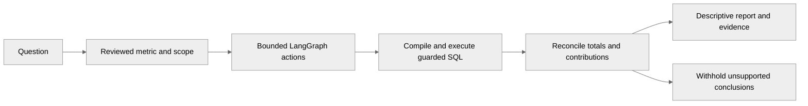
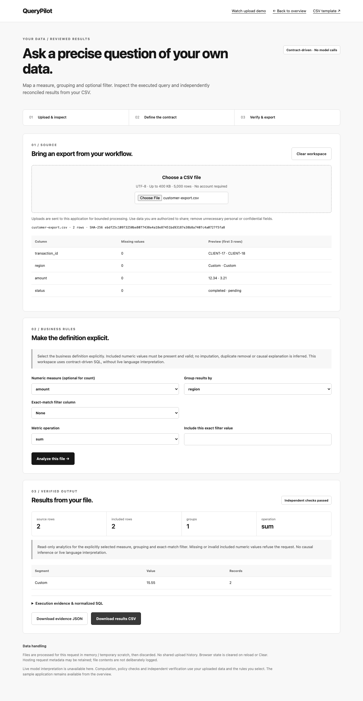

<p align="center"></p>

**Use your own data:** [Open the CSV workspace](https://querypilot-five.vercel.app/uploads) · [Contracts, verification and data handling](docs/product/USER-DATA.md). Upload, map columns, review business rules, and download checked source-derived results. Public processing is contract-driven; live model interpretation remains unavailable.

<p align="center"><a href="https://github.com/Akhilesh-Vangala/querypilot/actions/workflows/ci.yml"></a> &nbsp; Python · LangGraph · FastAPI · PostgreSQL</p>

# QueryPilot

**Analytical questions to executed evidence.** An agentic workbench for claims and provider-network investigations, reviewed metrics and reconciled period comparisons.

[**Open the app ↗**](https://querypilot-five.vercel.app) · [**Watch the recording ↗**](https://querypilot-five.vercel.app/recordings/) · [Technical documentation](docs/README.md) · [Repository layout](docs/development/LAYOUT.md)

## The business problem

Answer claims and provider-network questions with executed SQL, reviewed metric definitions and independently reconciled period comparisons.

<a id="the-operator-workbench"></a>
<a id="see-the-workbench"></a>

## Run the workflow

<picture>
  <source media="(prefers-reduced-motion: reduce)" srcset="docs/assets/demos/querypilot-demo-poster.png">
  
</picture>

**Actual execution, guided synthetic data.** The continuous recording shows real browser interactions and server results. No live model call, customer data or user-validation claim. [Recording provenance and reproducible capture](docs/DEMO.md).

Synthetic claims/network data and a guided investigator execute guarded SQL within the HTTP request. Compare periods across five reviewed metric families, inspect contributions and fifteen checks, export evidence for offline recomputation, and withhold unsupported future-period conclusions.

<a id="inside-the-agent"></a>
<a id="the-agentic-workflow"></a>
<a id="a-real-dbt-repair-workflow"></a>
<a id="what-is-engineered-here"></a>

## Architecture and authority



React and FastAPI connect authenticated admission to separate PostgreSQL workers. A bounded LangGraph controller uses typed native SDK actions and an independent read-only warehouse connection. The comparison subgraph compiles reviewed semantics, executes one statement, reconciles weighted contributions and produces inspectable evidence.



| Component | Owned responsibility |
| --- | --- |
| Frontend | React/TypeScript product pages, SQL/plan/verification tabs, comparison reports, evidence export and the recording player. |
| Backend | FastAPI identity/admission, bounded LangGraph actions, official Responses SDK transport, SQL policy and worker publication. |
| Independent checking | Read-only warehouse authority, execution receipts, reviewed comparison semantics and weighted contribution/Shapley accounting. |
| Persistent runtime | PostgreSQL admission, user-scoped history, separate leased workers and owner-fenced publication; interrupted work requires explicit resubmission. |
| Public demo | Request-bounded synthetic execution with browser-session history. Live inference and persistent cloud workers are separate. |

## Repository layout

```text
querypilot/
├── backend/
│   ├── app/
│   ├── tests/
│   ├── requirements/
│   └── docker/
├── frontend/
│   ├── src/
│   │   ├── app/
│   │   ├── features/
│   │   ├── components/
│   │   ├── lib/
│   │   └── styles/
│   ├── public/recordings/
│   └── config/
├── infrastructure/
│   └── containers/
├── scripts/
│   ├── checks/
│   ├── demos/
│   ├── deployment/
│   └── evaluation/
├── docs/
│   ├── architecture/
│   ├── operations/
│   ├── evaluation/
│   ├── project/history/
│   └── assets/
│       ├── branding/
│       ├── diagrams/
│       ├── screenshots/
│       └── demos/
└── .github/
```

[Component ownership and commands](docs/development/LAYOUT.md) · [Current handoff](docs/project/HANDOFF.md) · [Release plan](docs/project/PLAN.md)

<a id="run-it"></a>

## Run locally

```sh
git clone https://github.com/Akhilesh-Vangala/querypilot.git
cd querypilot
scripts/deployment/compose.sh up --build -d --wait db api worker frontend
```

Open **http://127.0.0.1:3007**. The Compose accounts/passwords are isolated development fixtures. The API, worker, frontend and warehouse are separate services.

Native development uses Python 3.13 and Node 24; install hashed dependencies from backend/requirements/development.txt and run npm ci in frontend/. Keep private configuration in ignored `.env`; never overwrite an existing private configuration. [Full development and deployment guide](docs/operations/DEPLOYMENT.md).

<a id="verified-evidence"></a>
<a id="evidence-honestly-scoped"></a>

## Engineering evidence

| Scope | Evidence |
| --- | --- |
| Test coverage | 137 backend cases, executed natively and in containers. PostgreSQL rehearsals cover four claimants, twelve original investigations and ten reviewed comparisons; frontend build/audit and browser/restart checks are required. |
| Known synthetic regression | Five metric families, ten supported metric/dimension combinations and ten known comparison regressions; unsigned exports support internal offline consistency checks. |
| Actual browser | Investigation, evidence/SQL, verification, download, reload/history, mobile layout and the native recording player. |
| Live model quality | **Not evaluated.** Public demos force guided mode; native transport tests use controlled providers. |
| Customer production | **Not certified.** Monitored persistent cloud delivery, individual/tenant authority where applicable and actual-user feedback remain release gates. |

```sh
python -m pytest -q backend/tests
npm ci --prefix frontend
npm run build --prefix frontend
python scripts/checks/check_repository.py
python scripts/demos/browser_smoke.py --url http://127.0.0.1:3007
```

Native commands run inside the project's installed environment. Required CI repeats the relevant checks on Linux. Test counts describe distinct cases; rerunning them in a container does not double the number of tests. [Evaluation and limits](docs/evaluation/README.md) · [Progress and source-linked evidence](docs/project/PROGRESS.md).

## Operating modes and limits

- **Guided public app:** real calculations over original synthetic fixtures; no paid generation. History remains in this browser session; the serverless filesystem is not durable coordination.
- **Private agent/runtime:** official OpenAI SDK, typed tools and bounded agent loops. A private provider key and explicit live selection are required; live quality and cost comparisons remain unmeasured.
- **Production boundary:** compiled comparisons are descriptive accounting, not causal inference or proof of model-selected intent. OIDC/tenant warehouse access, global cost controls, managed migrations, restore/load evidence and monitored cloud operation are open.

[Design decisions](docs/DECISIONS.md) · [Recorded demo](docs/DEMO.md) · [Branch policy](docs/development/BRANCHING.md) · [Contributing](.github/CONTRIBUTING.md) · [Dated history](docs/project/history/PRE-ORGANIZATION-README.md)

## Work with your own export

[Open the upload workspace](https://querypilot-five.vercel.app/uploads) · [Watch the actual file-to-result recording](https://querypilot-five.vercel.app/uploads/recording.html) · [Source-bound capture](docs/demos/uploads-recording.json).


