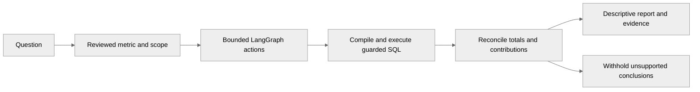

<p align="center"></p>

**Analytical questions to executed evidence.** [Open QueryPilot](https://querypilot-five.vercel.app/) · [Upload your data](https://querypilot-five.vercel.app/uploads) · [Docs](docs/README.md)

<p align="center"><a href="https://github.com/Akhilesh-Vangala/querypilot/actions/workflows/ci.yml"></a> &nbsp; Python · LangGraph · FastAPI · PostgreSQL</p>

# QueryPilot

Agentic analytics for claims and provider-network questions: reviewed metrics, guarded SQL, and independently reconciled period comparisons — without inventing causal claims the data does not support.

[**Open the app ↗**](https://querypilot-five.vercel.app/) · [Technical documentation](docs/README.md) · [Repository layout](docs/development/LAYOUT.md)

## Architecture




| Component | Responsibility |
| --- | --- |
| Frontend | Product pages, SQL/plan/verification tabs, comparison reports |
| Backend | FastAPI admission, bounded LangGraph actions, SQL policy |
| Independent checking | Read-only warehouse, receipts, contribution/Shapley accounting |
| Runtime | PostgreSQL workers and owner-fenced publication |

## Repository layout

```text
querypilot/
├── backend/          app, tests, requirements, docker
├── frontend/         React/TypeScript product UI
├── infrastructure/   containers
├── scripts/
├── docs/
└── .github/
```

## Run locally

```sh
git clone https://github.com/Akhilesh-Vangala/querypilot.git
cd querypilot
scripts/deployment/compose.sh up --build -d --wait db api worker frontend
```

Open **http://127.0.0.1:3007**. [Full deployment guide](docs/operations/DEPLOYMENT.md).

## Checks

```sh
python -m pytest -q backend/tests
npm ci --prefix frontend && npm run build --prefix frontend
python scripts/checks/check_repository.py
```

Public demos use guided synthetic fixtures (no live inference claim). Live model quality and customer production certification remain out of scope. [Evaluation](docs/evaluation/README.md) · [Demo notes](docs/DEMO.md)
