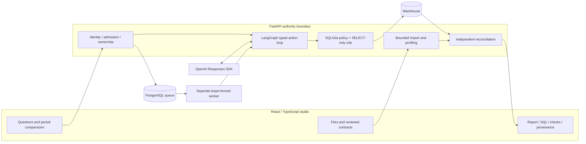

# QueryPilot

**Agentic analytics with an execution boundary you can inspect.**

QueryPilot turns analytical questions into bounded SQL investigations and evidence-backed reports. LangGraph orchestrates typed actions; application code controls warehouse authority, metric definitions, independent numerical checks and result publication.

[Open the studio](https://querypilot-five.vercel.app/) · [Analyze your data](https://querypilot-five.vercel.app/uploads) · [Technical report](docs/TECHNICAL-REPORT.md) · [Code map](docs/development/LAYOUT.md) · [CI](https://github.com/Akhilesh-Vangala/querypilot/actions/workflows/ci.yml)

## What it does

| Workflow | Input | Executed result |
| --- | --- | --- |
| File analysis | CSV, TSV, Excel `.xlsx`, JSON or JSONL; reviewed measure, group and filter | Sum, count or weighted overall average; SQL/Decimal reconciliation; signed evidence; CSV/JSON/SQL exports |
| Warehouse investigation | Claims/provider-network question and reviewed metric scope | Bounded tool trajectory, guarded read-only SQL, execution receipt, source-derived summary |
| Period comparison | Metric, dimension, baseline and comparison windows | Reconciled totals, weighted segment contributions, volume/mix/unit-cost accounting and independent checks |

The public Vercel app runs real file processing and a deterministic warehouse investigator. Its model mode is explicitly disabled. The private runtime includes the OpenAI Responses SDK integration and PostgreSQL workers. Verification results below measure software and known-case execution; they are not live-model accuracy claims.

## Architecture and authority



The model proposes actions. It cannot authorize relations, add tools, write warehouse data or certify its own answer. General SQL receives an **execution-only** receipt; compiled reviewed comparisons receive **semantic reconciliation** under their declared metric contract. Public file analysis uses a separate **declared-contract** verifier.

### Agent execution

1. Load reviewed metric definitions, permitted schemas and bounded previews.
2. Validate native function calls against local Pydantic action schemas.
3. Execute allowlisted tools with round, correction, repetition and query budgets.
4. Validate SQL through AST policy and a separate restricted database connection.
5. Reconcile reviewed comparisons in application code; derive displayed numbers from executed data.
6. Publish only under the current queue owner's lease; correlate events and evidence with a run ID.

[Graph and action policy](backend/app/agents/analytics/workflow.py) · [Native SDK transport](backend/app/agents/analytics/llm.py) · [SQL policy](backend/app/analytics/guardrails.py) · [Comparison subgraph](backend/app/analytics/comparison.py) · [Worker fencing](backend/app/persistence/runs.py)

### Concrete file-analysis result

Input:

```csv
region,amount,status
North,0.10,done
North,0.20,done
South,5.00,pending
```

Reviewed contract:

```json
{"mapping":{"group":"c0","measure":"c1","filter":"c2"},"options":{"operation":"sum","filter_value":"done"}}
```

Selected output fields:

```json
{
  "mode": "reviewed-aggregate",
  "live_ai": false,
  "summary": {"source_rows": 3, "included_rows": 2, "excluded_rows": 1,
              "groups": 1, "operation": "sum", "overall_value": "0.30"},
  "results": [{"segment": "North", "value": "0.30", "records": 2}],
  "checks": {"sql_sums_and_counts_match_decimal_reference": true}
}
```

SQL aggregates integer micro-units; a separate Python `Decimal` computation checks sums and counts. Missing included measures stop the calculation. Overall averages use all included values and their actual record count. The report retains exact decimal strings, source/contract/result fingerprints and a server signature. [Implementation](backend/app/uploads/service.py) · [Run schema](backend/app/core/run_contract.py) · [Report authentication](backend/app/uploads/signing.py)

## Verification

| Evidence | Reproducible check |
| --- | --- |
| Backend, policy, parser, protocol, provenance and verification regressions | `python -m pytest -q backend/tests` |
| TypeScript and production assets | `npm ci --prefix frontend && npm run build --prefix frontend` |
| Real file-to-report, save/reload, tamper refusal, restore, network recovery and keyboard/mobile paths | `python scripts/demos/product_browser.py` |
| All five formats, Excel sheet selection and unsafe-file rejection | `python scripts/demos/import_browser.py` |
| Five metric families, period reconciliation and offline report recomputation | `python scripts/demos/browser_smoke.py` |
| Actual containers, PostgreSQL roles, four-worker claims and restart recovery | [Required CI](.github/workflows/ci.yml) |

[Measured results and source-linked evidence](docs/evaluation/EVIDENCE.md) · [Evaluation methodology](docs/evaluation/README.md) · [Actual recorded walkthroughs](docs/DEMO.md)

## Run locally

```sh
git clone https://github.com/Akhilesh-Vangala/querypilot.git
cd querypilot
scripts/deployment/compose.sh up --build -d --wait db api worker frontend
```

Open `http://127.0.0.1:3007`. The Compose runtime separates API, worker, frontend and PostgreSQL. [Configuration and operations](docs/operations/DEPLOYMENT.md).

## Repository

```text
frontend/src/                 React pages, analytics views, product state and studio design
backend/app/agents/analytics/ LangGraph controller, typed tools and native model transport
backend/app/analytics/        Semantic contracts, SQL policy and comparison verification
backend/app/uploads/          Five-format parsing, exact aggregates and report signatures
backend/app/persistence/      PostgreSQL admission, leases and publication ownership
backend/app/workers/          Separate investigation worker
backend/tests/                Capability-level regression and boundary tests
infrastructure/               Compose services and owner-isolated account migration
scripts/                      Rehearsals, benchmarks, browser journeys and release checks
docs/                         Architecture, technical report, operations and evidence
```

**Stack:** Python 3.13 · FastAPI · Pydantic · LangGraph · OpenAI Responses SDK · SQLGlot · PostgreSQL · SQLAlchemy · React · TypeScript · Vite · Playwright · OpenTelemetry.
