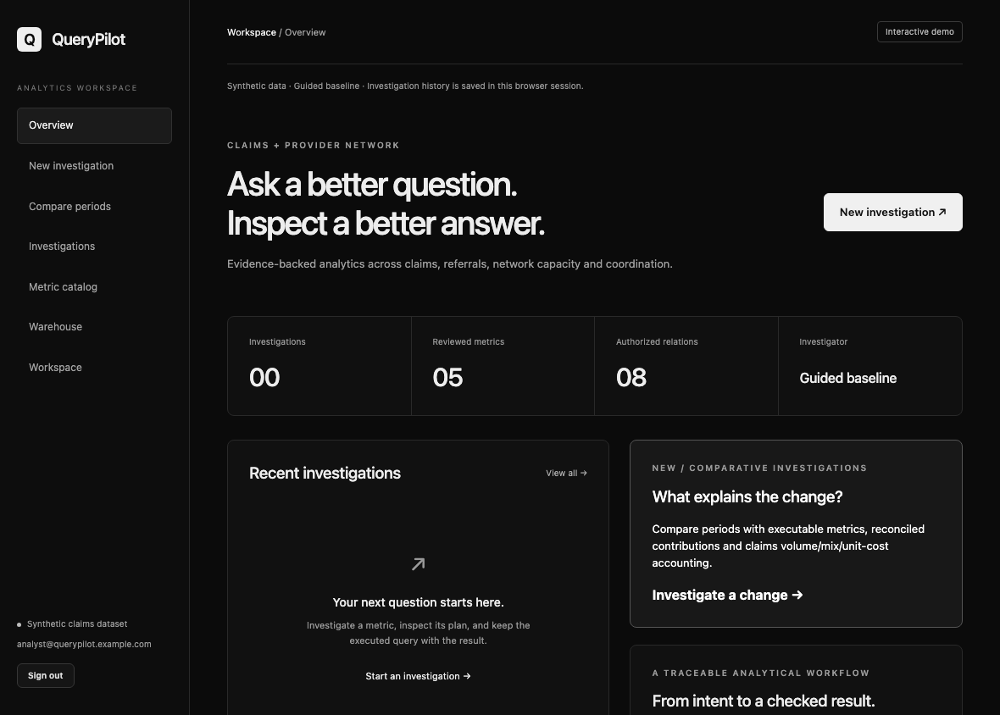

# QueryPilot recorded demonstration

[Open the working app](https://querypilot-five.vercel.app) · [Watch the continuous recording](https://querypilot-five.vercel.app/recordings/) · [Download the WebM](../frontend/public/recordings/querypilot.webm) · [Capture/source manifest](demos/interactive-recording.json)



The GIF is a six-frame preview. The WebM is a continuous Playwright screen recording of real browser interactions and server results; no generated UI, invented scores, model reasoning transcript or customer feedback is inserted. All data is original synthetic development data and no live model inference occurs.

| Stage | Actual captured behavior |
| --- | --- |
| 1 | overview |
| 2 | executed investigation |
| 3 | guarded sql |
| 4 | reconciled periods |
| 5 | independent checks |
| 6 | exported evidence |

## Scope and provenance

Video SHA256: `adeea0ce07c98ab5038be7d577c1d2c7f46a958f584bf284c552984de755d85f`. The [manifest](demos/interactive-recording.json) contains frame hashes, source hashes, browser checks and capture scope. The capture comes from the public guided deployment at source80ddc5966a207a721ee426226d49ece70d1f5aa5; the React and analytical backend source in this increment is unchanged. The recording player is added as a static frontend asset.

## Reproduce

```sh
python scripts/browser_smoke.py --url https://querypilot-five.vercel.app --record --publish-assets --source-commit <verified-deployment-sha> --screenshots artifacts/generated/demo-capture
```

Check the source commit of the URL before attributing a remote capture. The optional source-commit value is provenance supplied by the operator, not independently authenticated by the recording script. Raw captures and downloaded reports stay ignored.

The independent evidence download/recalculation, future-period withholding, reload and mobile checks run during the captured journey.

[Current system layout](development/LAYOUT.md) · [Private/public architecture](architecture/OVERVIEW.md) · [Evaluation limits](evaluation/README.md).
