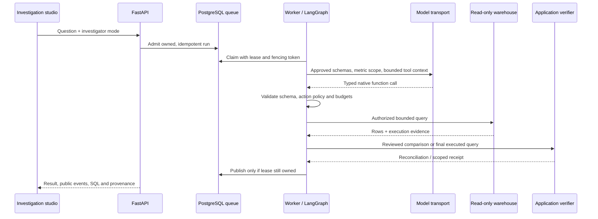

# QueryPilot: bounded analytical agents and independently checked evidence

[Source repository](https://github.com/Akhilesh-Vangala/querypilot) · [Working application](https://querypilot-five.vercel.app/) · [Execution evidence](evaluation/EVIDENCE.md)

## Problem and system contract

An analytical answer can execute successfully and still use the wrong denominator, period or grain. QueryPilot makes the analytical definition part of the execution artifact: source scope, reviewed metric, generated SQL, returned rows, reconciliation checks and provenance remain inspectable together.

The application serves two inputs. A file workspace profiles a bounded user-supplied table and executes explicitly reviewed aggregates. A warehouse studio investigates a synthetic claims/provider dataset using schema tools, reviewed metric definitions and bounded LangGraph actions. Period comparisons compile metric semantics into reconciled accounting reports. Both paths present evidence alongside their numerical result.

## Layers and ownership

| Layer | Owned implementation | Responsibility |
| --- | --- | --- |
| Interaction | [React features](../frontend/src/features/) | Source preview, metric review, comparison, reports, explicit saves and exports |
| Admission | [API routes](../backend/app/api/routes.py) | Identity, investigation admission and API contracts |
| Agent | [Workflow](../backend/app/agents/analytics/workflow.py), [protocol](../backend/app/agents/analytics/protocol.py) | Typed actions, public plan, bounded rounds, corrective opportunities and repeated-action refusal |
| Model transport | [SDK adapter](../backend/app/agents/analytics/llm.py) | Native Responses function calls, strict raw JSON, usage and timeout handling |
| Query authority | [SQL policy](../backend/app/analytics/guardrails.py), [warehouse](../backend/app/warehouse/service.py) | AST/relation/function policy and restricted read-only database execution |
| Semantic execution | [Catalog](../backend/app/analytics/catalog.py), [comparison](../backend/app/analytics/comparison.py) | Reviewed grain/time/denominator contracts, contributions and factor reconciliation |
| File verification | [Aggregate service](../backend/app/uploads/service.py) | Integer SQL sums/counts checked against a separate Decimal reference |
| Execution state | [Runs](../backend/app/persistence/runs.py), [worker](../backend/app/workers/worker.py) | PostgreSQL claims, leases, heartbeat and owner-fenced publication |
| Provenance | [Run contract](../backend/app/core/run_contract.py), [signing](../backend/app/uploads/signing.py) | Correlation, mode, hashes, verification scope and report authentication |

## Agent-to-result flow

The public guided investigator uses deterministic actions within the same application authority. The deployed function handles the request directly; the persistent queue/worker sequence belongs to the private Compose/PostgreSQL runtime.

## Investigation desk and execution inspection

The [question composer](../frontend/src/features/investigations/PromptComposer.tsx) opens an explicit review screen before execution. Reviewed starters populate the question; submission and investigator selection remain separate actions. The brief displays limits from `/api/config`, and the question survives sign-in through an [internal-route return guard](../frontend/src/lib/navigation.ts).

The [execution explorer](../frontend/src/features/investigations/ExecutionExplorer.tsx) renders actual backend events. Tool and verification filters preserve original sequence numbers; selected JSON is the exact public event payload. Timestamps mean elapsed time from run start. Recorded start events remain historical observations after completion. Input/output usage is shown only when reported for live mode; guided mode names its absence of provider use.

Plan navigation opens the published structured plan. Follow-up links start a fresh investigation with an explicit reference; they do not silently append previous results to model context. Reviewed comparison links select only catalog-supported metrics/dimensions. The browser rehearsal compares rendered event payloads with independently downloaded evidence, exercises question-preserving authentication, and rejects external/API/backslash return destinations.

## Numerical verification

File analysis converts supported decimal values to integer micro-units before SQL aggregation. Independently grouped `Decimal` values provide a separate reference. Both sum and count must match; an unequal-group average is computed as total included value divided by included record count. No missing numeric measure is imputed, and no repeated record is silently removed.

Reviewed period comparisons compile five metric families across supported dimensions and time windows. Additive totals reconcile by segment; rates and means use weighted contributions rather than summing segment-rate differences. Claims accounting distributes volume, mix and unit-cost interaction effects across all six factor orders. These decompositions describe the observed change; they do not estimate causality.

Reconciliation and oracle tests cover unequal segment distributions, zero denominators, incomplete periods, filters, Simpson-style shifts, altered evidence and misleading factor decompositions. [Detailed semantics](architecture/SEMANTIC-INVESTIGATIONS.md).

## Execution and verification scopes

| Scope | Evidence supports |
| --- | --- |
| `declared-contract` | A supplied table and reviewed aggregate reconcile under the chosen rules |
| `execution-only` | Exact analytical SQL executed under the enforced database/policy boundary |
| `semantic-reconciliation` | A compiled reviewed metric comparison passes its deterministic accounting checks |

A query receipt is not proof that arbitrary natural language was interpreted correctly. Fingerprints detect changed content; a server signature authenticates a report. Neither establishes that the original business source was truthful or current.

The `run-v1` record includes execution identity, mode, owner scope, input/contract/result hashes, producer versions, check/evidence counts and billing origin. Existing signed reports without this newer record remain readable. Provenance metadata does not contain raw rows, SQL or credentials.

## Operational design

Private workers claim jobs with PostgreSQL `FOR UPDATE SKIP LOCKED`. Progress and final publication are fenced on the current owner. An expired lease becomes interrupted; a paid generation is not automatically replayed. Graph execution is in-process, so worker recovery and graph checkpoint recovery are distinct properties.

The public Vercel function uses request-local file processing and ephemeral synthetic warehouse initialization. Device saves require consent and retain immutable browser snapshots. Restore validates the complete backup and authenticates retained results before atomic import. The optional account adapter uses provider-validated identity and owner-isolated PostgreSQL RLS when configured; the public device workspace works without it.

Optional OpenTelemetry spans expose investigation/model/query timing and operational categories. Exported spans exclude prompts, questions, SQL, result rows and secrets. Bounded SSE progress preserves a terminal result separately from coalesced updates and enforces an actionable deadline.

## Design tradeoffs

- **Reviewed metric compilation:** gives stronger evidence for selected metric families while keeping arbitrary SQL's narrower execution-only scope explicit.
- **Independent numerical code:** provides a reproducible oracle for declared calculations without asking a second model to certify the first model's answer.
- **Separate warehouse authority:** places SELECT permissions and deadlines in the database as well as AST policy in the application.
- **Serverless public workflow and persistent private runtime:** makes the public workspace directly usable while preserving a distinct, testable queue/worker deployment.
- **Exact strings and micro-units for uploaded aggregates:** avoids floating-point drift within the accepted decimal contract and keeps all exported values inspectable.
- **Explicit retained snapshots:** preserves analytical context with consent and avoids presenting a historical report as a fresh source-system check.

## Observed results

The investigation-desk increment exercises eight prompt/auth/trace/follow-up groups and ten additional accessible views. Combined with the file/import/studio journeys, 42 views report zero axe A/AA violations. Tool counts and selected event payloads are compared with downloaded backend evidence. [Current UI execution summary](evaluation/agent-desk-results.json).

The October 25 current-source run passes 200 backend tests, the TypeScript/Vite build, 11 grouped product journeys and 8 grouped import journeys. Across 32 automated accessibility views, axe reports zero WCAG A/AA violations. The warehouse journey executes all five metric contracts and inspects five segments, three accounting factors and fifteen comparison checks; its downloaded report passes offline recomputation. These are deterministic implementation results with zero provider calls. [Machine-readable summary](evaluation/studio-results.json).

## Reproduction and evidence

The required CI runs backend/policy regressions, TypeScript/production build, actual containers, PostgreSQL roles and four-worker recovery exercises. Browser rehearsals perform real file selection, reviewed rules, SQL/Decimal results, report authentication, export, save/reload, restore, network errors, keyboard navigation and responsive/accessibility checks. Continuous recordings identify source and media hashes.

[Commands and results](evaluation/EVIDENCE.md) · [Evaluation protocol](evaluation/README.md) · [Deployment](operations/DEPLOYMENT.md) · [Continuous recordings](DEMO.md).

## Dependency and deployment consistency

The frontend uses React19 with an explicitly imported React element type at its protected-route boundary. Runtime/renderer/type packages are upgraded together. Python runtime and development locks retain hashes; root `pyproject.toml` and `uv.lock` specify Vercel installation. The repository check rejects version drift between those environments, with negative regression cases for backend-only, deployment-lock and test-lock changes. Actual browser recordings are refreshed when their captured source changes. [Executed release evidence](evaluation/dependency-release-results.json).
