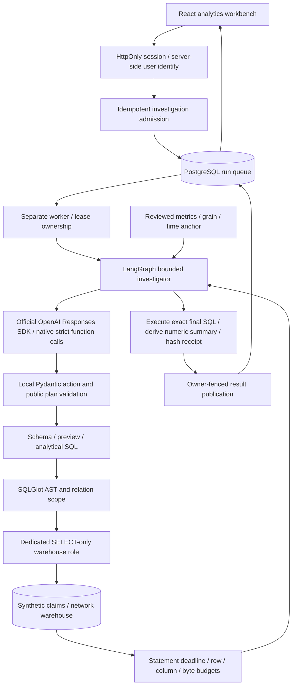

# Evidence-backed analytical investigations

New executable metric comparisons: [full design](SEMANTIC-INVESTIGATIONS.md). The `compare_metric` action routes into an owned compile/execute/reconcile/report subgraph; exploratory SQL retains the narrower execution-only guarantee. Both guided and live investigator selection use this same application-owned authority.

QueryPilot helps a claims/network operations analyst answer questions that span a warehouse: which specialties dominate spend, where referrals decline, whether provider panels are closed, and how coordination cost varies. The difficult part is preserving metric meaning while allowing flexible questions. Units, grain, denominators, time anchors and completeness must remain inspectable.

The new workbench owns the policy and execution loop. LangGraph orchestrates model actions; an application-owned executor validates each action and controls database access. The model can propose analytical SQL, inspect approved schemas/previews, declare a public plan and request a result. It cannot add tools, change the warehouse scope, read application identities, remove bounds or write data. Answer numbers come from executed rows rather than unverified model prose.

## Two operating paths

**Private persistent runtime:** FastAPI, a separate Python worker and PostgreSQL. Admission survives API restart. Workers claim with `FOR UPDATE SKIP LOCKED`, refresh a 60-second lease and fence progress/result publication on ownership. Expired leases become `interrupted`; paid generation is never automatically replayed. Graph state is in-process, not checkpointed. A worker crash does not resume midway through its model calls. Retained public events identify its last reported step; a new investigation requires explicit submission.

**Public Vercel demonstration:** React build and FastAPI run together as one function. Synthetic data is initialized in ephemeral `/tmp`; a deterministic investigator runs within the requesting HTTP call. The UI retains up to 30 results in that browser's session storage. Shared server history endpoints return empty/404. No worker daemon or durable serverless filesystem is claimed. This entrypoint forcibly disables live AI and provider credentials.

## Owned agent stages

1. **Scope:** authorized relation metadata and five reviewed metric contracts. PostgreSQL relation sizes are estimates; previews use the same read-only execution boundary as analytical queries.
2. **Plan:** native `record_plan` declares objective, approved metric identifiers, assumptions and checks. This is a public analysis artifact, not hidden chain of thought. The deterministic comparator creates a clearly labeled development plan itself.
3. **Investigate:** tools are strictly allowlisted. Local schema validation remains required even when native function schemas are strict. Invalid SQL/actions produce at most two corrective opportunities; repeated identical actions and round/query ceilings prevent runaway loops.
4. **Execute:** AST relation/function scope with qualified functions/custom types refused, startup denial of unreviewed executable custom public functions, separate connection, read-only transaction, restricted PostgreSQL role, statement timeout and bounded output. Joining two raw facts at the same scope is rejected; aggregate them first. This rule prevents one common fan-out pattern, not every possible semantic join mistake.
5. **Publish:** the exact final query must have an execution receipt in this run. Receipt reuse avoids duplicate identical execution. Rows determine the displayed numeric summary; metadata includes SQL, conservative truncation flag, result hash, attempts, public events, elapsed time and SDK token usage.

## Defaults and limitations

| Allowance | Default |
| --- | --- |
| Investigator rounds | 8 |
| SQL executions | 3 |
| Corrective opportunities | 2 |
| Result rows / columns | 500 / 64 |
| Result payload | 250 KB |
| Model context characters | 48,000 |
| Tool rows supplied to model | At most 20 |
| SQL statement deadline | 8 seconds |
| Model output tokens / reported total tokens | 1,024 / 24,000 |
| Active run capacity | 16 globally |

Token accounting is checked after provider responses and before further rounds; it is not a hard dollar cap. SDK transport timeout is 30 seconds, retries are disabled, and exceptions fail the run without paid replay. Model token generation is returned as complete responses; public file-analysis progress uses bounded SSE. The row-cap flag is conservative: exactly 500 returned rows may mean a complete result or truncation.

SQL safety and successful execution do not establish that a model chose the right denominator, time window, join or interpretation. The metric catalog supplies guidance, not a universal semantic theorem prover. The original weekly “last 12 months” benchmark means 52 snapshots anchored on latest data. Monetary fixture columns remain floating point; their financial interpretation follows the fixture schema. This is organization-shared synthetic data with user-scoped investigations, not multi-tenant enterprise row-level access control.

## Observability

Public events expose stages and operational outcomes. Optional OTLP HTTP tracing emits investigation/model/query spans with round, mode, dialect and error category. Prompt text, questions, SQL, result rows, passwords and exception bodies are not exported. Configure a private collector via `OTEL_EXPORTER_OTLP_ENDPOINT`; exporter headers remain local secrets. No hosted collector deployment or monitored live-model evidence is implied.

## Code map

| Responsibility | Source |
| --- | --- |
| Graph / action policy | [workflow.py](../../backend/app/agents/analytics/workflow.py), [protocol.py](../../backend/app/agents/analytics/protocol.py) |
| Native model transport | [llm.py](../../backend/app/agents/analytics/llm.py) |
| Semantic contracts | [catalog.py](../../backend/app/analytics/catalog.py) |
| SQL / warehouse authority | [guardrails.py](../../backend/app/analytics/guardrails.py), [tools.py](../../backend/app/agents/analytics/tools.py), [production_checks.py](../../backend/app/core/production_checks.py) |
| Persistence / workers | [runs.py](../../backend/app/persistence/runs.py), [worker.py](../../backend/app/workers/worker.py) |
| Identity / rate limits | [auth.py](../../backend/app/security/auth.py), [rate_limits.py](../../backend/app/core/rate_limits.py), [api.py](../../backend/app/api/routes.py) |
| Reproducible evidence | [workbench tests](../../backend/tests/api/test_workbench.py), [Postgres rehearsal](../../scripts/deployment/postgres_rehearsal.py), [browser journey](../../scripts/demos/browser_smoke.py) |

Official design references: [OpenAI native function calling](https://developers.openai.com/api/docs/guides/function-calling), [strict structured outputs](https://developers.openai.com/api/docs/guides/structured-outputs), [PostgreSQL transaction controls](https://www.postgresql.org/docs/current/sql-set-transaction.html), [SQLGlot](https://github.com/tobymao/sqlglot), [LangGraph](https://docs.langchain.com/oss/python/langgraph/overview).
