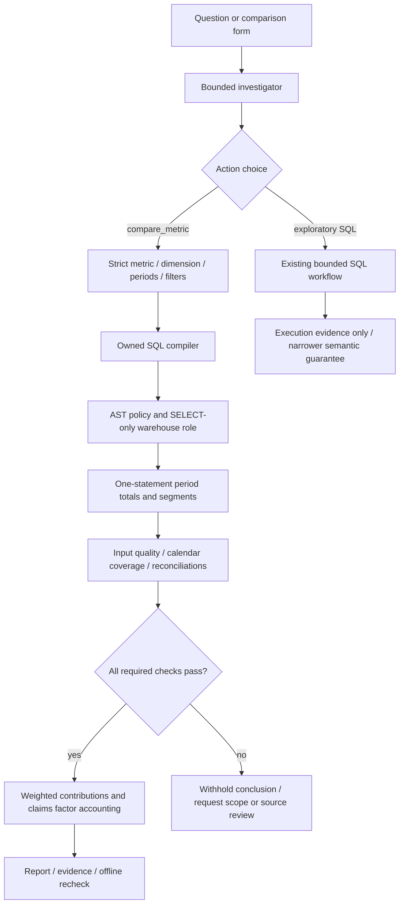

# Executable metric investigations

## Business journey

An operations analyst sees claims spend increase and needs to separate scale, changing specialty/employer mix and changing cost per claim. Another analyst needs to compare referral decline rates without confusing changes in volume weights with changes in provider rates. QueryPilot now supports a complete reviewed comparison rather than asking a language model to invent the analytical arithmetic.

Open **Compare periods**, select one of five metrics, its compatible dimension and two explicit calendar windows. The application compiles SQL, executes both periods with separate total and segment aggregates in one statement, checks the evidence and publishes a reconciled report. The question composer also accepts **“What explains the change in claims paid between Q1 and Q2 2026?”** Guided mode uses an explicitly deterministic template; a privately configured live investigator can select the same strict `compare_metric` function from a flexible question. No live-model score is implied.



The nested LangGraph has explicit `compile_metric`, `execute_snapshot`, `verify_accounting` and `publish_report` nodes. The outer graph retains bounded schema inspection, planning, correction and exploratory SQL. The model chooses an action and scope; it cannot supply expressions, joins or SQL through the comparison tool. Reports are generated by application code, with no second-model self-grading step. Inner graph checkpoints remain deferred; the PostgreSQL queue still owns leases and fenced publication.

## Executable contract

`ComparisonRequest` rejects extra fields, unknown metrics, incompatible dimensions, duplicate filter dimensions, reversed/overlapping periods, noncanonical dates and windows longer than 366 days. Dates are half-open `[start,end)`; the baseline precedes the comparison. Filters are exact matches on reviewed dimensions. Literal values are SQLGlot-escaped, not interpolated as identifiers or expressions. The form supports the unfiltered guided journey; the strict live tool additionally supports bounded exact-match filters. Unsupported guided questions clarify rather than silently dropping qualifiers into a legacy intent.

| Metric | Execution | Compatible dimensions |
| --- | --- | --- |
| Claims paid | Sum paid USD; claim volume retained for accounting | Specialty, employer name |
| Declined referral rate | Sum declined / sum referrals | Specialty, region code |
| Referral wait | Sum wait × referrals / sum referrals | Specialty, region code |
| Closed panels | Sum closed flags, in provider-weeks | Specialty, employer name |
| Coordination cost | Sum spend / sum cases | Region code, employer name |

Every query touches one reviewed fact and its compatible key-linked dimensions. Both periods and independently aggregated total/segment branches execute in the same read-only statement. This gives PostgreSQL statement-snapshot consistency and avoids comparing totals from different model rounds. It does not create a durable warehouse snapshot that can be queried again later.

Checks include non-null/nonnegative inputs, declined counts no greater than referrals, zero-volume spend inconsistencies, positive ratio denominators, bounded complete output, source-date bounds, expected weekly snapshot count, observed weeks versus calendar weeks, and numerator/denominator/observation reconciliation. A missing calendar week is rejected too. Coverage uses the warehouse's weekly calendar convention; it does not establish that every provider/employer/region record was ingested or that the calendar itself is trustworthy. Production source ingestion needs separate completeness and freshness contracts. Negative spend is outside this reviewed metric contract; credit/reversal workflows would need an explicitly different contract.

## Descriptive change accounting

For additive metrics, segment contribution is the segment's comparison value minus its baseline value. For weighted ratios, contribution is `segment numerator / overall denominator` in each period; subtract these weighted contributions across periods. The sum equals the observed overall metric change. A segment's standalone rate difference is shown separately and is **not** treated as an additive contribution. This matters when composition changes cause Simpson's paradox. Relative change is undefined when the baseline is zero; zero denominators remain undefined rather than becoming zero rates.

Claims spend additionally factors as `V × sum(w[s] × p[s])`: total claim volume, claim-volume segment weights, and per-segment paid cost per claim. The three-factor Shapley calculation switches these factors from baseline to comparison in each of their six possible orders and averages their marginal changes. Volume, mix and unit-cost components therefore distribute interaction terms and reconcile to total spend change. These are descriptive accounting components, not established causes, and this is not an ML classifier's SHAP explanation. New/removed/zero-volume segments have undefined unit cost; factor attribution becomes unavailable without silently imputing a price. The additive segment report remains available when its other checks pass.

Arithmetic uses Decimal after reading the original floating-point fixture fields; tolerances are explicit (`max(1e-6, abs(total)×1e-10)`). Decimal cannot restore lost storage precision. A real monetary migration is still future work.

## Evidence and offline recheck

The report retains the typed request, contract version, executed SQL, raw aggregate columns/rows, coverage metadata, checks, limitations and content SHA-256. Numbers are normalized to canonical decimal strings for fingerprinting so a browser converting `123.0` to `123` does not invalidate an unchanged download. The product exports the run as `querypilot-report-v1` JSON. Run:

```sh
python scripts/evaluation/verify_report.py path/to/querypilot-run.json
```

The verifier needs neither a model key nor a database. It checks the typed-request/raw-aggregate fingerprint and recomputes the comparison object from retained aggregates. Display prose and unrelated export metadata are outside that fingerprint. This detects accidental changes/inconsistent summaries; an unsigned hash does not authenticate origin, stop a party from replacing both rows and hash, prove natural-language intent, or certify the source data. Model prompts/hidden reasoning are not included in operational trace attributes.

## Evaluation and limits

`backend/tests/analytics/test_semantic.py` supplies independently authored row-level oracles over three uneven data distributions, all five metric families and ten metric/dimension combinations. It also checks quoted filters, hostile literal values, overlap/unsupported scope, missing/empty/future periods, missing calendar/observed weeks, negative/invalid counts, zero denominators, truncation, corrupted totals, isolated Shapley factors, undefined segment prices and altered exported evidence. This is compiler/accounting regression evidence, not live-model question understanding.

`scripts/evaluation/comparison_benchmark.py` compares ten reviewed Q1/Q2 questions with separately authored quarterly SQL, checks selected scope as well as totals and segment values, records rounds/attempts/latency/tokens and hashes the source. Default mode has zero model calls; live mode requires a private key, `ALLOW_LIVE_AI=true` and `--ack-live-spend`. The original 12-case regression and 34-case filtered/safety suite remain separately scoped. The new known templates are not renamed as held-out model accuracy.

Customer pilot gaps remain: live quality/cost comparisons, managed migrations, OIDC/organization warehouse permissions, shared spend reservations, backup restore, controlled checkpoints, retention, persistent monitored cloud staging, load/SLO evidence and actual user feedback. Vercel continues to serve a forced synthetic guided demo with browser-session history.

## Implementation and references

- `backend/app/analytics/semantic.py`: strict contracts, compiler, metric checks and Shapley accounting.
- `backend/app/analytics/comparison.py`: owned LangGraph subworkflow.
- `backend/app/analytics/evidence.py`: reusable offline verification packaged with the backend; CLI and tests import this module without depending on repository layout.
- `backend/app/agents/analytics/llm.py`: native Responses call IDs, typed function outputs and replayed response items; generation retries remain disabled.
- `frontend/src/features/comparisons/Compare.tsx`, `frontend/src/components/reports/ComparisonReport.tsx`: scope form, report, contribution display and export.
- `backend/app/evaluation/comparisons.py`: independent known-case SQL oracles, never imported into model context.
- [OpenAI function calling](https://developers.openai.com/api/docs/guides/function-calling): strict object schemas and correlated native tool results. Local validation and business checks remain application-owned.
- [MetricFlow](https://docs.getdbt.com/docs/build/about-metricflow): reference for centralized executable metric semantics. Five supported metrics justify the small owned compiler here; no dbt/warehouse compatibility claim or unused dependency.
- [Semantic evaluation with distilled test suites](https://aclanthology.org/2020.emnlp-main.29/): motivation for independent data variants rather than treating one successful SQL execution as semantic correctness.
